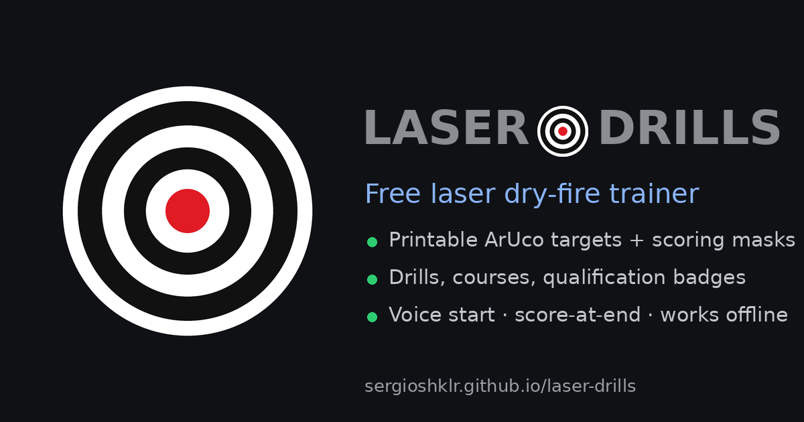
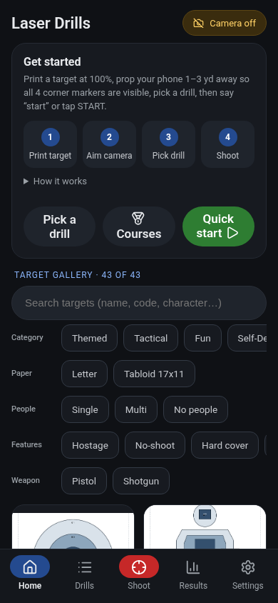
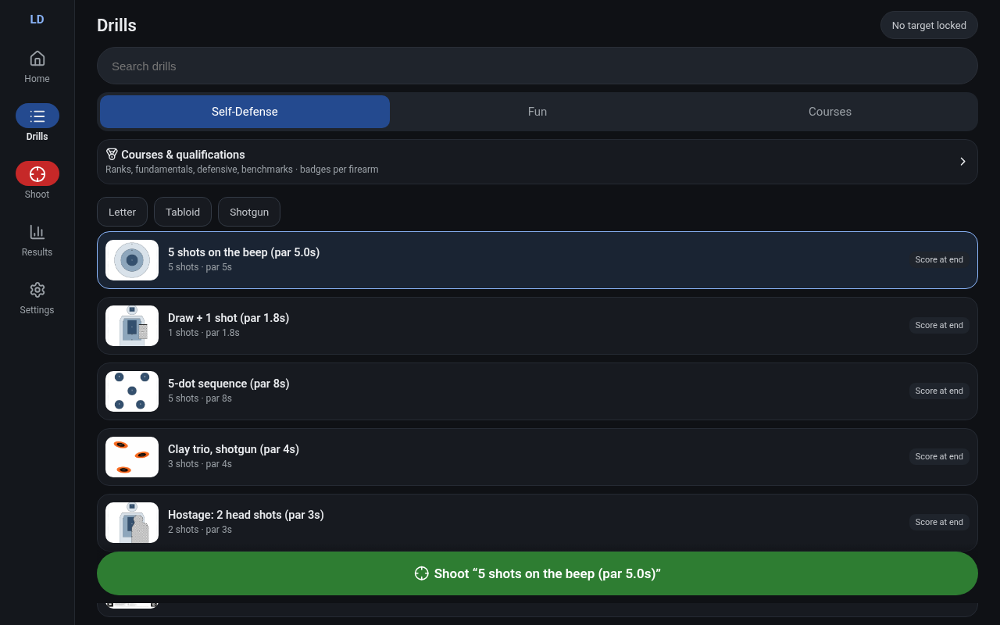
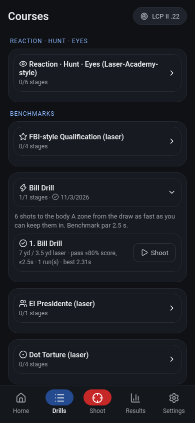
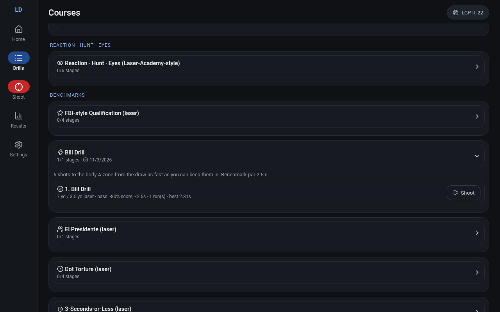

<p align="center"></p>

# Laser Drills: dry-fire laser trainer (PWA)

**Live:** https://sergioshklr.github.io/laser-drills/ · **Repo:** `sergioSHKLR/laser-drills`

Laser Drills is a free, installable web app for laser dry-fire training. It's a full-featured alternative to commercial laser-trainer apps. You print a target, point your phone or laptop camera at it, and shoot with any laser cartridge or trainer. The app finds the target by its four ArUco corner markers, detects each laser flash, scores it against the target's zone map, and times it from a random start beep. Everything runs in the browser and works offline.



| Phone | Desktop |
|---|---|
|  |  |
|  |  |

---

## Contents
1. [Features](#features)
2. [Quick start](#quick-start)
3. [Targets, masks and legend](#targets-masks-and-legend)
4. [Drills](#drills)
5. [Courses and badges](#courses-and-badges)
6. [Firearm profiles and history](#firearm-profiles-and-history)
7. [Settings](#settings)
8. [Voice commands and keyboard shortcuts](#voice-commands-and-keyboard-shortcuts)
9. [Printing](#printing)
10. [Offline use and installing](#offline-use-and-installing)
11. [Laser-safe colors](#laser-safe-colors)
12. [Project structure](#project-structure)
13. [Data formats](#data-formats)
14. [Tool scripts](#tool-scripts)
15. [Testing](#testing)
16. [Deployment](#deployment)
17. [Credits and licenses](#credits-and-licenses)

Detailed pages are in [`docs/`](docs/): [targets](docs/targets.md) · [masks](docs/masks.md) · [drills](docs/drills.md) · [courses](docs/courses.md) · [data formats](docs/data-formats.md) · [development](docs/development.md) · [design notes](docs/design-notes.md).

## Features
- **Camera hit detection:** js-aruco finds the 4 corner markers and locks onto the target, which gives the target's ID and a homography. A red-dominance and frame-difference laser detector picks out each pulse. Hits map to target inches and are scored against the zone map.
- **43 printable targets:** in Self-Defense, Tactical, Themed and Fun categories, on Letter and Tabloid (17×11, always landscape). Each target has a separate **scoring mask** sheet.
- **63 drills:** par time drills, sequences, IDPA-style points-down scoring, random called targets, shoot/don't-shoot, Crowd Hunt, Ankle Draw (kneel behind cover), Die Hard themed sets, and games (carnival, battleship, poker, call-outs).
- **15 courses (58 stages):** NRA-style qualification ranks, fundamentals, defensive pistol, Laser-Academy-style reaction/hunt/eyes drills, and benchmarks (FBI-style qual, Bill Drill, El Presidente, Dot Torture, 3-Seconds-or-Less, Core Skills, 5×5). Each course earns a badge **per firearm**.
- **Score at end (IDPA mode):** hits stay hidden during the string, then the results are revealed and spoken. There's an optional neutral shot tick.
- **First Responders:** optional post-string police commands, scored on whether you comply.
- **Firearm profiles:** history is kept per gun, with stats (best, average, trend, fails), CSV export, JSON export and import (merge or replace), and reset.
- **Hands-free control:** voice commands (Web Speech API), Bluetooth media buttons and the keyboard. There's never a "shoot to start" zone.
- **Zone editor:** draw custom zones and share them as a link.
- **Installable PWA:** offline cache, app shortcuts (Shoot, Drills, Courses, Results), maskable icons and Open Graph/Twitter cards.
- **Lucide icons:** bundled with the app, so there's no CDN dependency.

## Quick start
1. Open the app (HTTPS, or `http://localhost` for local use). Camera access needs a secure context.
2. **Home** › target gallery › pick a target › **Target PDF**. Print it at **100% / Actual size**.
3. Prop the phone 1–3 yd from the target so all 4 corner markers are visible.
4. **Shoot** › *Start Camera*. Wait for the blue outline (target locked).
5. Pick a drill (**Drills**) or a course stage (**Courses**). Say **"start"** or tap **START**. After a random delay there's a beep, then shoot.

## Targets, masks and legend
Every sheet follows one template: consistent print-safe margins, four ArUco markers with white quiet zones (nothing overlaps them), a header band (name, code, distance, paired drills), a footer band (instructions, a scoring map drawn with circle swatches), and artwork scaled to fill the field inside the margins. The artwork has **no dotted outlines**. Scoring zones live only on the separate **mask sheet** (`targets/<key>-mask.pdf/png`), which shows the zones in the legend colors below.

| Zone type | Mask color |
|---|---|
| Hit | navy `#1F4E9A` |
| No-hit / no-shoot | white with black hatching |
| Hard cover | black |
| Two-hit | green `#2E8B57` |
| Conditional | purple `#7B4FA0` |
| Head-only | teal `#00A3B4` |
| Backstop (bystander behind) | gray `#8C8C8C` |

The art is full-color rendered illustration. Characters are faceless, with no actor likeness. Blank mask templates are linked at the bottom of Home. Full catalog: [docs/targets.md](docs/targets.md). Legend details: [docs/masks.md](docs/masks.md).

## Drills
Drills are grouped as **Self-Defense**, **Fun** and the older multi-stage IDPA-style **Courses**. You can filter by target, by the locked target, by paper size, or to shotgun drills. Each drill sets its shot count, random start delay, par time, timeout and scoring:
- **Points:** sum of zone points, shown as a percentage of the maximum.
- **IDPA-style:** final = raw time + 1 s per point down + 3 s per procedural error (PE) + 5 s per hit on a non-threat (HNT). Bystander or backstop hits add 10 s.
- **Sequence, calls, scenario, crowd:** shot order and the target to engage are announced at run time.
- **Games:** carnival, battleship, poker hand and call-out.

Full list: [docs/drills.md](docs/drills.md).

## Courses and badges
**Drills › Courses & qualifications** (or **Home › Courses**) opens the Courses page. Each course is an ordered list of stages built from existing drills, with stage overrides (shots, par, timeout, target) and **pass standards**: minimum score %, maximum time, maximum IDPA final, and/or no fail. Tap **Shoot** on a stage and it opens in the Shoot tab. When the string ends, the result shows *STAGE PASSED* or *stage not passed (standard)*, and the app speaks it.

| Group | Courses |
|---|---|
| Qualification ranks (NRA-style ladder) | Pro-Marksman › Marksman › Sharpshooter › Expert › Distinguished Expert. Each rank unlocks after the previous one. |
| Fundamentals | Pistol Fundamentals (groups at 3/5/7/15 yd, scaled) |
| Defensive | Defensive Pistol (draw, ankle draw kneeling, movement, shoot/don't-shoot, multiple threats) |
| Reaction · Hunt · Eyes | Laser-Academy-style reaction, Crowd Hunt, Friend or Foe, decision |
| Benchmarks | FBI-style qual, Bill Drill, El Presidente, Dot Torture, 3-Seconds-or-Less, Core Skills, 5×5 |

Progress comes from your run history. Course runs are tagged with `course`, `stage` and `pass`. So badges are **per firearm profile** and are included in export, import and reset. All courses are **original adaptations**, not official materials, and confer no certification. Stage tables are in [docs/courses.md](docs/courses.md).

## Firearm profiles and history
- **Settings › Firearms:** add, edit or delete profiles (name, type, caliber, optic/laser, suppressor, notes). Choose the active one with the **Firearm** chips in Shoot. A shotgun profile turns on shotgun mode. Deleting a profile keeps its runs and moves them to *Unassigned*.
- **Results:** filter by date range and by firearm. Shows best, average, trend (recent half vs earlier half) and fails, plus a sparkline chart.
- **Export:** CSV (one row per run) or JSON (`{app, kind:'history', version, firearms, runs}`).
- **Import:** a JSON file, either merged (duplicate runs are skipped by `id`) or replacing everything.
- **Reset:** all runs, or only one firearm's runs.

## Settings
| Setting | Default | Effect |
|---|---|---|
| Score at end (IDPA) · Self-Defense | **On** | Hides hits, hit sounds and live score until the string ends, then reveals them |
| First Responders · Self-Defense | Off | After the string, simulated police give commands. Stop shooting and comply (say "okay, complying" or tap **Comply**). Any shot after the first command adds 20 s and is a FAIL |
| Score at end · Fun | Off | Off means live feedback |
| Shot tick | On | Neutral beep per detected shot while hits are hidden |
| Shotgun mode | Off | Grows hit zones by the shotgun spread (default 1.5 in) |
| Viewfinder | Medium | Height slider and presets, minimize during drill (detection keeps running) |
| Calibrate detection | — | Laser thresholds (`redMin`, `redDom`, `diffMin`, pixel limits, refractory, background), fps and mask view |
| Zone editor | — | Custom zones per target, saved locally and shareable as a `#zones=` link |

## Voice commands and keyboard shortcuts
Tap the **mic** in Shoot to turn on continuous listening (no wake word). Commands: **start** / **standby**, **stop**, **reset**, **next**, **repeat**, **score**. Recognition pauses during live strings so shot clicks can't trigger anything. In shoot/don't-shoot scenarios only verbal commands ("Drop it!", "Show me your hands!") are accepted, and with First Responders on, so are compliance phrases.

| Key | Action |
|---|---|
| Space / Enter | Start or stop (on the Shoot tab) |
| Esc | Stop |
| Media play/pause | Start or stop |
| Media next / previous | Next stage / repeat |

## Printing
- Print at **100% / Actual size**, never "fit to page". Use matte paper and keep the corners flat.
- Letter sheets work on any printer. Tabloid (17×11) sheets are landscape.
- Each target's header gives its simulated distance (for example *3 yd ≈ 13.5 yd sim*, 1/4.5 scale). Course stages list both the standard and the laser distance.
- Print the mask sheet only if you want to see where the zones are. Don't shoot at it.

## Offline use and installing
The service worker (`sw.js`, cache `ld-v43`) precaches the app shell, data, icons and the Lucide sprite. It's network-first, falling back to the cache, so updates arrive as soon as you're online and old caches are deleted on activation. To install: in Chrome/Edge use **Install app** in the address bar or menu. On iOS Safari use **Share › Add to Home Screen**. The manifest provides maskable icons, narrow and wide screenshots, and shortcuts to Shoot, Drills, Courses and Results.

## Laser-safe colors
Detection looks for red-dominant flashes, so **scoring zones never use red or orange**. Tiers are cool blue/grey, the top score is the darkest tier, the IDPA practice -0 circles are dark blue, and the kraft tone is desaturated. `gen_assets.py` and `tools_diehard_safe.py` check red-dominance (kept under about 40) and grayscale luminance steps, so zones can still be told apart in grayscale. Green lasers work too.

## Project structure
```
index.html            app shell (views, styles, inline Lucide sprite)
app.js                camera, detection loop, drill runner, voice, First Responders
ui.js                 router/tabs, gallery, drill picker, results/history, firearms, courses
core.js               pure logic (scoring, IDPA, games, history import/export, courses); Node-testable
editor.html/.js       zone editor
sw.js                 service worker (cache ld-v43)
manifest.webmanifest  PWA manifest
targets.json          target specs: markers, layout, zones, meta
drills.json           drill definitions
courses.json          course definitions (generated by tools_courses.py)
targets/              generated PDFs/PNGs (art + masks) and catalog.json
art/                  rendered illustration sources
vendor/               cv.js, aruco.js (js-aruco), lucide/ (sprite + LICENSE)
icons/, favicon.ico   favicons, apple-touch-icon, maskable icons
og-image.png          1200x630 social card
screenshots/          manifest/README screenshots
docs/                 detailed documentation
test/                 frame fixtures and test runners
tools_*.py, gen_assets.py   generators (below)
```

## Data formats
In short (full schemas are in [docs/data-formats.md](docs/data-formats.md)):
- **targets.json:** `{template, targets:{key:{code,name,markerIds[4],distance,zones[],scoring?,layout?,meta,metaOverride}}}`
- **drills.json:** `[{id,name,category,target|targets,shots,startDelay[2],parTime,timeout,scoring?,maxPerShot?,sequence?|calls?|scenario?|crowd?|game?,notes}]`, or `{type:'course',stages:[…]}`
- **courses.json:** `[{id,group,name,badge,icon,requires?,notes,stages:[{name,drill,brief,dist,set,pass}]}]`
- **localStorage:** `ld.history`, `ld.firearms`, `ld.fw`, `ld.sae`, `ld.tick`, `ld.fr`, `ld.vf`, `ld-settings`, `ld-zones`

## Tool scripts
| Script | Output |
|---|---|
| `gen_assets.py` | Target and mask PDFs/PNGs, `targets/catalog.json`, mask templates |
| `tools_build_specs.py` | IDPA-style and hostage target specs |
| `tools_games.py` / `tools_clays.py` / `tools_crowd.py` | Game, clay and Crowd Hunt targets and drills |
| `tools_diehard.py` / `tools_diehard_safe.py` | Die Hard themed set and laser-safe color pass |
| `tools_ankle.py` | Ankle Draw retail-store set |
| `tools_courses.py` | `courses.json` |
| `tools_icons.py` | Lucide sprite (inlined into `index.html` and `vendor/lucide/sprite.svg`); needs an extracted `lucide-static` package |
| `tools_silhouette.py` | Qualification silhouette spec (line art + X/10/9/8 zones) |
| `tools_pwa_assets.py` | Favicons, maskable and apple-touch icons, `og-image.png` |

## Testing
```
node test/run_test.js        # marker lock + laser detection + scoring on recorded frames
node test/game_test.js       # games, calls, IDPA summaries, history import/export
python3 test/editor_test.py  # zone editor (headless)
```
Also check by hand: serve with `python3 -m http.server`, open each tab at phone and desktop widths, and check that there are no console errors and icons render. See [docs/development.md](docs/development.md).

## Deployment
GitHub Pages serves `main` from the repo root. Bump the cache name in `sw.js` (`ld-vNN`) with every release, push to `main`, wait about 1 minute, then check `https://sergioshklr.github.io/laser-drills/sw.js`.

## Credits and licenses
- **Lucide icons** © Lucide Contributors, ISC License (`vendor/lucide/LICENSE`), https://lucide.dev
- **js-aruco** © 2011 Juan Mellado, MIT License (`vendor/aruco.js`, `vendor/cv.js`)
- IDPA-style, NRA-style, FBI-style and Laser-Academy-style content is **original work inspired by** those formats. It isn't affiliated with or endorsed by IDPA, NRA, the FBI or Mantis. Target artwork is original, with faceless characters.
- Safety: use only with an unloaded firearm, a dedicated laser trainer or a snap cap, in a room with no live ammunition.

## Versioning

Settings › About shows the semver version (starting 1.0.0), build date/time (America/Sao_Paulo), short commit hash and service-worker cache name, read from `version.json`. Stamp it with `python3 tools_version.py [X.Y.Z]` after committing the source (the hash is that source commit), then commit `version.json`. See `docs/development.md`.

## Branding

`brand/wordmark.svg` (gray bold LASER ◎ DRILLS) and `brand/mark.svg` (bullseye). Red appears only in the bullseye centre of the app/brand art, never on printed sheets (the PDF header is plain text). Icons, maskable icons, favicons and `og-image.png` are regenerated with `python3 tools_pwa_assets.py`.
